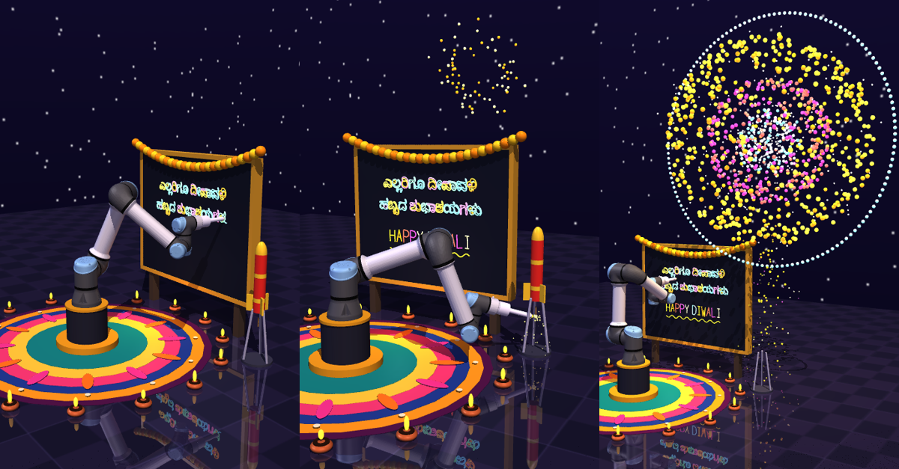
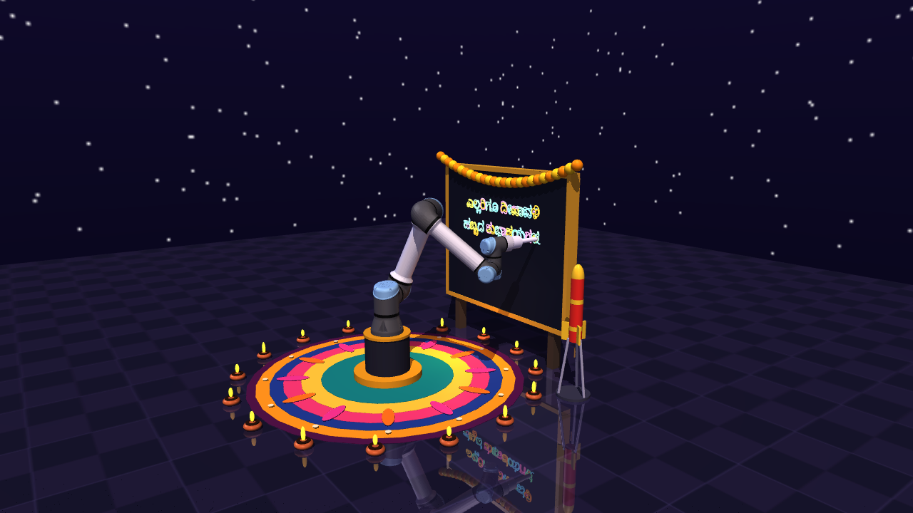
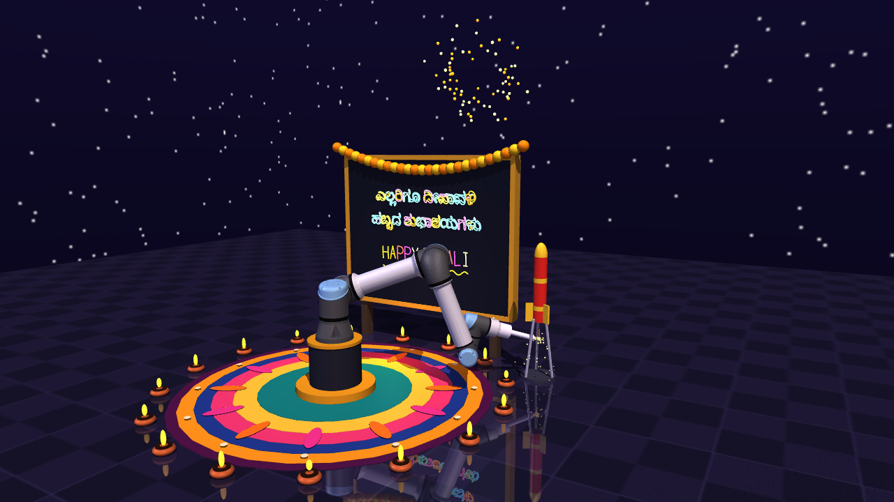
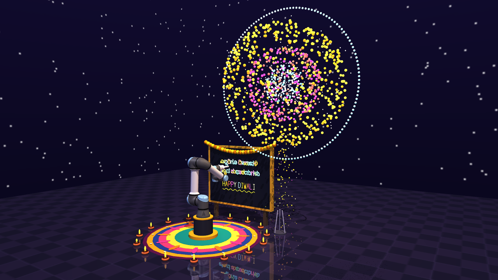

# 🪔 Diwali Robot — a UR5e cobot writes Kannada Diwali wishes in MuJoCo

A **Universal Robots UR5e** cobot (open-source model from [MuJoCo Menagerie](https://github.com/google-deepmind/mujoco_menagerie)) writes

> **ಎಲ್ಲರಿಗೂ ದೀಪಾವಳಿ ಹಬ್ಬದ ಶುಭಾಶಯಗಳು**

on a board, adds a small **HAPPY DIWALI** below it, then **lights the fuse at the bottom of a rocket**. The rocket lifts off and bursts into a big firework in the sky.
Everything runs **offline** in a single Python file, with live speed control.



| Kannada writing | Fuse ignition | Big blast |
|---|---|---|
|  |  |  |

## Features
- UR5e with damped-least-squares inverse kinematics and a pen-direction constraint
- Kannada text shaped with HarfBuzz and converted from glyph outlines into pen strokes (embedded in the script, no font install needed)
- Fuse lighting at the rocket's bottom, lift-off, and a particle-based blast
- Rangoli, 16 diyas with flicker, marigold garland, auto-camera
- Live speed control (0.2x to 3x)

## Quick start (macOS / Linux / Windows)
```bash
pip install mujoco numpy
# macOS needs mjpython for the interactive viewer:
mjpython diwali_robot.py        # (or ~/Library/Python/3.9/bin/mjpython diwali_robot.py)
# Linux / Windows:
python diwali_robot.py
```
The `universal_robots_ur5e/` folder is included. If it is missing, the script downloads it from MuJoCo Menagerie.

## Viewer controls
| Key | Action |
|---|---|
| ↑ / `+` | faster |
| ↓ / `-` | slower |
| `0` | normal speed |
| `Space` | pause / resume |
| `R` | replay |
| `C` | auto camera / free camera |

## Other modes
```bash
python diwali_robot.py --speed 1.5                 # start faster
python diwali_robot.py --text "HAPPY DIWALI"       # change English text
python diwali_robot.py --no-kannada                # English only
python diwali_robot.py --record diwali.mp4         # render a video (slow, be patient)
python diwali_robot.py --still frame               # save PNG stills at key moments
python diwali_robot.py --selftest                  # headless check
```

## How it works
1. Kannada glyph outlines are flattened and simplified (RDP) into polylines, then laid out on the board.
2. A timeline gives the pen target at every moment (write, wave, approach fuse, hold, retreat).
3. IK solves joint angles each step, and stiff PD gains with feedforward lag compensation keep pen error low (about 5 mm RMS on dense Kannada, versus 11.6 mm with default UR5e gains).
4. Ink dots, sparks and the blast are mocap bodies and a particle pool.

## Credits and licenses
- Robot model: **UR5e** from [MuJoCo Menagerie](https://github.com/google-deepmind/mujoco_menagerie) (BSD-3-Clause, see `universal_robots_ur5e/LICENSE`)
- Kannada glyph outlines: **Noto Sans Kannada** (SIL Open Font License 1.1)
- Simulator: [MuJoCo](https://mujoco.org) (Apache-2.0)
- My code: MIT (see `LICENSE`)

Built by **Lohith M R** ([RinoScientist](https://www.linkedin.com/)), Bengaluru. Happy Diwali! 🎆
